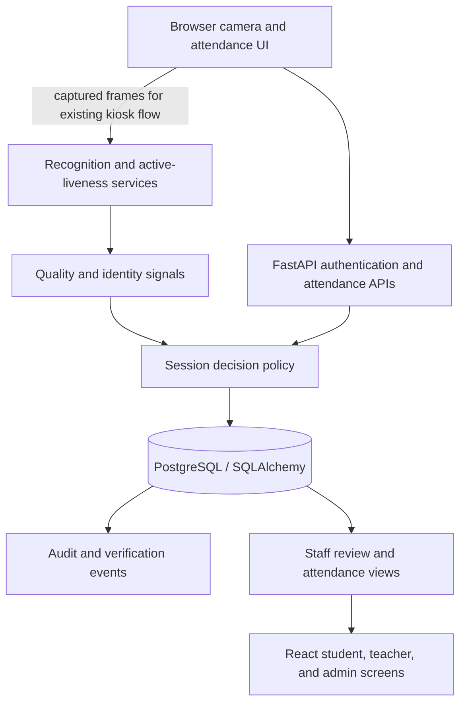

# Smart Attendance System — Architecture Blueprint and Build Guide

This guide replaces the earlier hardware-heavy reference proposal with a plan grounded in the current AttendX repository. It separates shipped behavior from proposed work, avoids unmeasured recognition or anti-spoofing claims, and keeps the existing application and attendance records intact.

## 1. Product direction

AttendX is a web-based attendance and academic management system. Today, a user checks in through a browser camera flow; the backend performs face recognition and server-side active liveness checks. Staff can also run class sessions, review uncertain decisions, and record reasoned manual overrides.

The next upgrade should make session attendance safer and more observable, then add multi-person camera processing only after a representative camera evaluation. A room-edge appliance, passive infrared liveness, mobile radio ranging, and automated facial tracking are optional research directions, not current system capabilities or prerequisites for improving the web product.

### Design principles

1. Preserve the existing React, FastAPI, SQLAlchemy, and Alembic application; extend it in small, reversible migrations.
2. Keep the legacy daily attendance workflow working while session-based attendance matures.
3. Treat recognition scores as signals for a policy decision. Do not describe them as accuracy or proof of identity without evaluation data.
4. Make uncertain cases reviewable and provide a usable non-biometric attendance path.
5. Minimize biometric collection and retention; never include face images or embeddings in ordinary API responses or event logs.
6. Ship only controls connected to real backend behavior, and distinguish implemented features from planned work.

## 2. Current implementation

The repository already includes:

- **Frontend:** React 18, JavaScript, MUI, CRA/Craco, camera capture, browser-side MediaPipe guidance, role-aware student/teacher/admin screens, academic management, and a session live monitor.
- **Backend:** FastAPI, SQLAlchemy 2, Alembic, JWT authentication, role checks, audit logging, rate limiting, health/readiness routes, and InsightFace/ArcFace recognition.
- **Attendance:** existing per-day attendance plus additive class sessions. Session decisions use `VERIFIED`, `REVIEW_REQUIRED`, `REJECTED`, `DUPLICATE`, and `MANUAL_OVERRIDE` outcomes. Decision inputs and outcomes are recorded without raw biometric frames.
- **Liveness:** the legacy camera workflow uses active, server-issued head-turn challenges. A passive PAD candidate previously failed the repository's real-image evaluation, so passive PAD is not enabled or claimed as protection.
- **Operations:** PostgreSQL in deployment, SQLite for local development, Docker Compose, frontend deployment support, and CI.

The session monitor currently polls the API and displays a camera preview. Its decision endpoint accepts scores and flags produced elsewhere; the preview itself does not run a multi-face recognition pipeline. There is no ByteTrack integration, edge-node deployment, offline event queue, RF ranging, or WebSocket feed today.

See [CURRENT_ARCHITECTURE.md](CURRENT_ARCHITECTURE.md), [DECISION_ENGINE.md](DECISION_ENGINE.md), [DATABASE_SCHEMA.md](DATABASE_SCHEMA.md), and [FRONTEND.md](FRONTEND.md) for implementation details.

## 3. Recommended target architecture



### Request flow

1. The user authenticates and selects the active class/session.
2. The browser requests the session's state and submits a verification using the existing capture flow or a supported fallback.
3. The server checks authorization, session state, duplicate status, liveness, image quality, and recognition result.
4. The decision engine returns a stable outcome. Low-quality or ambiguous cases go to staff review rather than being silently marked present.
5. A transaction writes the session attendance row and an audit/verification event. Database uniqueness constraints remain the final duplicate guard.
6. The UI refreshes from the API and exposes the decision reason to the appropriate user or staff member.

### Service boundaries

- **Capture and guidance:** browser camera access and user instructions. Browser-side checks improve capture quality but are not a trusted security boundary.
- **Recognition:** server-side detection, alignment, embedding extraction, and matching. Keep model version and threshold metadata with verification events.
- **Liveness:** retain the current active challenge until a passive model has a documented license, threat model, and evaluation on the actual camera population and attack types.
- **Decision policy:** pure, deterministic policy that consumes named signals and yields one of the documented outcomes. The decision policy must not claim that an upstream signal is accurate merely because it passed a threshold.
- **Persistence and audit:** relational transactions, unique constraints, reasoned overrides, and append-only decision history.
- **Live monitor:** use the existing bounded polling endpoint at current scale. Add server push only when measured polling load or latency warrants it.

## 4. Data and privacy controls

Face embeddings and enrollment images are sensitive biometric data even when stored without names. The existing database stores biometric records; separation, encryption, and retention controls are incomplete and should be addressed before expanding enrollment or deploying to a new institution.

### Required engineering work

- Add explicit enrollment/processing consent records and a withdrawal path tied to face-template revocation.
- Define retention periods for enrollment images, templates, verification events, and audit metadata. Delete data through an auditable process when the purpose ends.
- Minimize retained enrollment imagery. If images are not necessary after enrollment quality review, avoid keeping them by default; document any exception and its retention period.
- Separate account/profile data from biometric templates using an opaque reference. Restrict template access to the recognition service and authorized enrollment/deletion flows.
- Encrypt sensitive biometric fields using a managed key in deployed environments. Plan key rotation and revocation; do not store encryption keys alongside encrypted values.
- Ensure logs, error reports, analytics, exports, and API schemas do not expose image bytes, embeddings, tokens, or unnecessary identity attributes.
- Offer an equivalent non-biometric attendance path (for example, staff confirmation or a time-limited class code) and record which method was used without penalizing users for opting out.
- Review the deployment's notice, consent, access, correction, deletion, and retention processes with the institution's privacy/legal owner before production use. Legal requirements depend on jurisdiction and deployment context.

Cancelable biometric transforms or vector encryption do not by themselves establish legal compliance or eliminate biometric risk. Treat them as controls to evaluate in a threat model, not as a compliance claim.

## 5. Reliability and security

- Keep attendance writes transactional and idempotent. Use database uniqueness for one decision per student/session and return clear conflict responses.
- Authenticate every session decision. Students may submit only for themselves; teachers may manage only their assigned classes; admins retain scoped administrative access.
- Require a reason and actor identity for manual overrides and review resolutions.
- Use server time as the authoritative timestamp. Keep timezone conversion at the presentation/reporting boundary.
- Keep request limits, security headers, CORS allowlists, strong production secrets, and audit records enabled in production.
- Move process-local challenge and rate-limit state to a shared store before running multiple backend workers if those controls must work across replicas.
- Add retry-safe event ingestion before implementing offline mode. An offline client must retain event IDs, surface pending/failed sync, and reconcile server responses without silently dropping attendance attempts.
- Back up the database and test restore procedures. Apply schema changes through Alembic and preserve a single migration head.

## 6. Incremental build plan

### Stage A — Close the session workflow gaps

**Goal:** make existing session decisions reliable and properly scoped.

- Review session list, get, records, and event endpoints for class/student visibility rules.
- Ensure decision submission requires authentication and that the session is active before accepting a verification.
- Make duplicate submission behavior deterministic under concurrent requests using the unique constraint and transaction handling.
- Store the decision policy version and threshold used, and normalize event timestamps.
- Add explicit non-biometric fallback behavior and staff review outcomes.

**Exit conditions:** unauthorized cross-user/class reads are denied; retries cannot create duplicate attendance; every override has an actor and reason; existing daily attendance remains functional.

### Stage B — Privacy and lifecycle

**Goal:** establish defensible handling for biometric records.

- Add consent, revocation, and retention records with migrations that preserve existing data.
- Implement restricted template access, encryption using deployment-managed keys, and deletion workflows.
- Update enrollment UI and privacy notices to explain the purpose, retention, and fallback path.
- Review all logs, exports, admin routes, and backups for unnecessary biometric exposure.

**Exit conditions:** enrollments can be withdrawn and purged; key rotation is documented; ordinary API/log output contains no template values; retention behavior is observable and auditable.

### Stage C — Recognition and decision evaluation

**Goal:** measure the actual workflow before changing models or thresholds.

- Build a consented, access-controlled evaluation set representative of the intended cameras, lighting, distances, and user population.
- Separate tuning and held-out evaluation data. Record false match and false non-match behavior at the intended operating point, including subgroup checks where lawful and appropriate.
- Record capture quality, recognition, liveness, review, and operator-override metrics without retaining unnecessary imagery.
- Tune thresholds only from evaluation results and document model/version changes.

**Exit conditions:** reproducible evaluation procedure, reviewed operating thresholds, failure/override report, and a rollback path. Do not advertise numeric accuracy until measured and reviewed.

### Stage D — Optional multi-face camera pipeline

**Goal:** explore faster room entry only if the institution needs it and the capture geometry supports it.

- Start with a separate scanner service/API so the existing single-user kiosk remains stable.
- Evaluate detection and tracking on the actual fixed camera; associate temporary track IDs, select a small number of quality frames per track, and match only when the face size and quality pass documented limits.
- Keep track IDs ephemeral. Never use tracking for continuous behavior, emotion, or attention scoring.
- Require human review for uncertain matches and provide visible signage and an equivalent fallback.
- Evaluate CPU/GPU hardware from measured end-to-end latency, thermals, cost, maintainability, and camera support. Do not select a Jetson/Raspberry Pi/RF stack from vendor TOPS or paper FPS alone.

**Exit conditions:** documented camera placement and performance measurements, false match/review rates on held-out footage, attack evaluation, and privacy review. If performance is insufficient, keep single-user capture.

### Stage E — Resilience and live operations

**Goal:** support unreliable networks and larger live sessions.

- Add an idempotent batch API and durable client/edge queue with bounded retries, backoff, event IDs, and operator-visible synchronization state.
- Add WebSocket/server-sent events only if polling is a demonstrated bottleneck; retain a polling fallback.
- Exercise network loss, duplicate submissions, partial batch failures, restarts, clock skew, and database recovery.

**Exit conditions:** no silent event loss in the agreed fault scenarios, deterministic duplicate reconciliation, and clear operator visibility for unresolved sync errors.

## 7. Verification and measurement

The repository already has automated tests and CI. For each code phase, extend the relevant tests and report actual results; do not infer performance from model papers or vendor material.

Suggested measurements for a real pilot:

| Area | Measure |
|---|---|
| API | p50/p95/p99 latency and error rate by endpoint |
| Camera flow | capture completion, quality rejection, and user retry rate |
| Recognition | false match / false non-match on held-out, consented data |
| Liveness | attack presentation and genuine-user rejection rates by attack/camera condition |
| Operations | review rate, override rate, duplicate conflicts, unresolved sync events |
| Infrastructure | CPU/RAM, model load time, database query time, and cost per active session |

Set targets after measuring the current baseline and agreeing on the institution's acceptable error and latency trade-offs. Published benchmark numbers from another dataset or device are not acceptance evidence for this deployment.

## 8. Deployment shape

```text
React application (Vercel or Nginx container)
                  │ HTTPS + bearer token
                  ▼
FastAPI application (Render or container platform)
                  │ TLS database connection
                  ▼
PostgreSQL (managed service or local Docker Compose)
```

The current hosted setup and Docker Compose files remain the reference deployment. Browser camera access requires a secure browser context in deployed environments. The frontend API URL is build-time configuration. Apply migrations through the established deployment workflow and confirm `/ready` after rollout.

For an edge deployment, first define who administers devices, how updates and keys are provisioned, how a lost device is revoked, what happens offline, and whether the institution can patch and monitor each node. Keep raw video local only if the full design, security boundary, and operational controls support that promise.

## 9. Decisions to revisit with evidence

- Whether multi-face tracking solves a measured entrance bottleneck.
- Whether passive PAD is licensed, compatible with selected hardware, and effective on representative attack data.
- Whether templates need a dedicated vector store; at current scale the existing relational storage and matching path avoid an extra service.
- Whether WebSockets or a mobile companion app provide enough operational value to justify their added deployment and maintenance cost.
- Whether a room-edge node is supportable by the institution's IT operations.

These decisions should follow an evaluation or operational requirement, not a benchmark headline.
