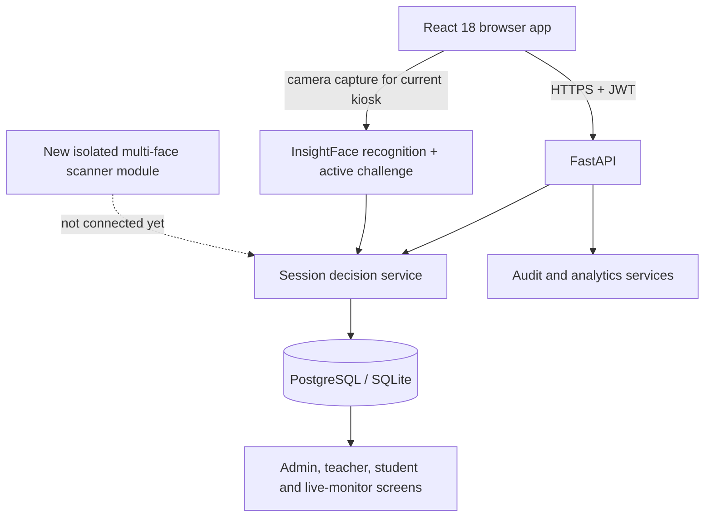

# Current Architecture

**Status date:** 2026-11-22. This describes the implemented application and clearly marks the new scanner module that is not yet wired to attendance.

## System shape

## Frontend

- React 18 JavaScript, MUI 5, CRA/Craco, React Router, Axios, Recharts, and Framer Motion.
- Browser camera components and MediaPipe guidance support the existing check-in flow.
- Role-based screens exist for admin, teacher, and student, alongside academic CRUD, session management, live monitor, settings, analytics, and audit views.
- API calls use an Axios bearer-token interceptor. The live session monitor polls; it does not currently receive WebSocket events.

## Backend and API

- FastAPI app factory in `backend/app/main.py`, Pydantic schemas, SQLAlchemy 2, and Alembic.
- Legacy routers are mounted under their current paths and additively under `/api/v1`; academic and session routers declare versioned paths directly.
- Route handlers are declared async, while database work uses synchronous SQLAlchemy sessions.
- Middleware provides CORS, request correlation, security headers, and rate limiting. Central exception handling avoids returning SQL/internal exception details.
- Auth dependencies validate bearer tokens and active accounts; staff/student dependencies gate roles.
- Session routes now restrict score-based decision submission to staff who manage the session, require enrollment for class-linked targets, scope session reads, limit student record reads to the caller, and restrict event feeds to session managers. The browser monitor no longer submits editable CV signals.

## Recognition and liveness

### Current kiosk path

Browser captures image frames → FastAPI upload/validation → InsightFace SCRFD detector and ArcFace recognition → image quality checks and cosine/k-NN gallery match → server-issued head-turn challenge where required → attendance/session decision.

- Existing recognition uses InsightFace and a configured model pack (`buffalo_l` by default), with normalized embeddings stored in the database and a process-local NumPy matching cache.
- The recognizer chooses the largest face for the single-user flow; it is not a multi-person tracker.
- Existing quality checks cover face size, detection confidence, blur, and brightness heuristics. These scores are not calibrated error rates.
- Browser blink guidance is not accepted as proof by itself. Passive PAD is not deployed; a prior candidate behaved poorly on genuine enrollment imagery.

### New isolated scanner service

`backend/app/services/multiface.py` provides:

- SCRFD detector-only inference through InsightFace, returning boxes, five landmarks, detector scores, and simple capture-quality features.
- `ByteTrackTracker`: Kalman prediction, high-confidence association followed by low-confidence recovery, high-confidence-only track birth, confirmation, and expiry.
- Ephemeral sequential track IDs; IDs are process-local and are not identities.
- ArcFace 112×112 five-landmark alignment and L2-normalized embedding on a confirmed track's improved quality frame only.
- Cosine similarity and vector normalization helpers.

This module has no camera capture, persistent tracker, room gallery, authorization/session integration, or production API route. It must not be advertised as an end-to-end live feature until those integrations and physical-camera evaluation are complete.

## Database

Core tables include users, daily attendance, face embeddings/images, audit logs, notifications, shifts, holidays, leave/correction requests, departments, academic sessions, courses, teachers, students, classes, class enrollments, attendance sessions, session attendance, and verification events. See [DATABASE_SCHEMA.md](DATABASE_SCHEMA.md) for migration details.

- PostgreSQL is the production target; SQLite supports local development and tests.
- Legacy daily uniqueness `(user_id, date)` remains. Session uniqueness `(session_id, user_id)` guards one session record per student.
- No pgvector, edge-device registry, signed sync-event, consent, or dedicated encrypted-template schema currently exists.
- Face embeddings and captured enrollment image bytes are database-backed but not application-layer encrypted.

## Deployment and operations

- `docker-compose.yml`: PostgreSQL, FastAPI backend, and nginx-served frontend.
- Dockerfiles support independent frontend/backend builds.
- Repository README documents Vercel, Render, and Neon deployment.
- `/health` checks process liveness; `/ready` checks database connectivity.
- CI runs backend tests/migration-head checks and frontend tests/build. Actual deployment health was not verified in this audit.
- Rate-limit and challenge stores are process-local; multi-replica consistency requires shared storage.

## Known constraints

1. No physical camera or GPU evaluation for the new scanner.
2. Client-provided decision signals are not trusted proof of identity/liveness; a server-owned recognition flow or authenticated edge-device attestation is needed before automated session acceptance relies on them.
3. Biometric consent, application encryption, retention, deletion, and non-biometric self-service fallback remain incomplete.
4. No offline edge queue, event batch API, device authentication/heartbeat, proximity verification, or WebSocket feed.
5. API paths are only partially versioned; handlers use sync SQLAlchemy sessions inside async functions.
